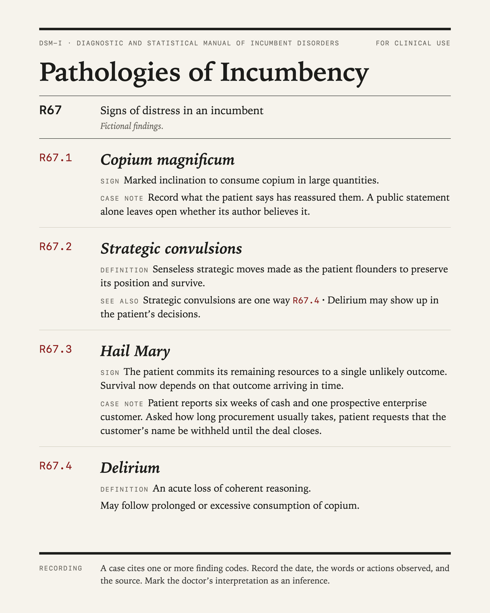

# Pathologies of Incumbency

**DSM-I · Diagnostic and Statistical Manual of Incumbent Disorders, First Edition**

A clinical reference for the signs of incumbent distress. Any resemblance to a company you have been watching is a matter for your own judgment.

## Contents

1. [Classification](#1-classification)
2. [Cases](#2-cases)
3. [Contributing](#3-contributing)
4. [Forks and local editions](#4-forks-and-local-editions)
5. [License](#5-license)

## 1. Classification

R67 · Signs of incumbent distress.

| Code | Condition |
|---|---|
| [R67.1](conditions/R67.1-copium-magnificum.md) | Copium magnificum |
| [R67.2](conditions/R67.2-strategic-convulsions.md) | Strategic convulsions |
| [R67.3](conditions/R67.3-hail-mary.md) | Hail Mary |
| [R67.4](conditions/R67.4-delirium.md) | Delirium |

Each entry gives diagnostic criteria, specifiers, recording procedures, features, prevalence, course, risk factors, differential diagnosis and comorbidity. Each condition has its own file in [`conditions/`](conditions/) and its own card in [`cards/`](cards/).

## 2. Cases

A case cites one or more finding codes. Record the date, the words or actions observed, and the source. Mark the doctor’s interpretation as an inference.

Case reports follow the form of a clinical case report, including a mental status examination of the patient. Patients are recorded by type, never by name: “a document-system founder,” not the company. See [`cases/`](cases/) for the template and a completed example.

## 3. Contributing

Two ways to contribute, both described in [CONTRIBUTING.md](CONTRIBUTING.md):

- **Report a case.** Open an issue with the *Report a case* template, or add a file to `cases/`.
- **Propose a condition.** Open an issue with the *Propose a condition* template. The editors assign codes.

## 4. Forks and local editions

Fork freely. Two conventions keep editions compatible with this one:

- **Extensions use `.8`.** Conditions you add under an existing category take codes ending in `.8` (“other specified”), e.g. `R67.8x`. They will not collide with codes assigned here, and good ones can be brought back.
- **New chapters take a new letter.** An edition for another kind of patient (venture firms, media companies, governments) opens its own chapter rather than renumbering R67.

## 5. License

Text and cards: [CC BY 4.0](LICENSE). Reuse, adapt and fork, with attribution to *Pathologies of Incumbency (DSM-I)* and a link to this repository.
